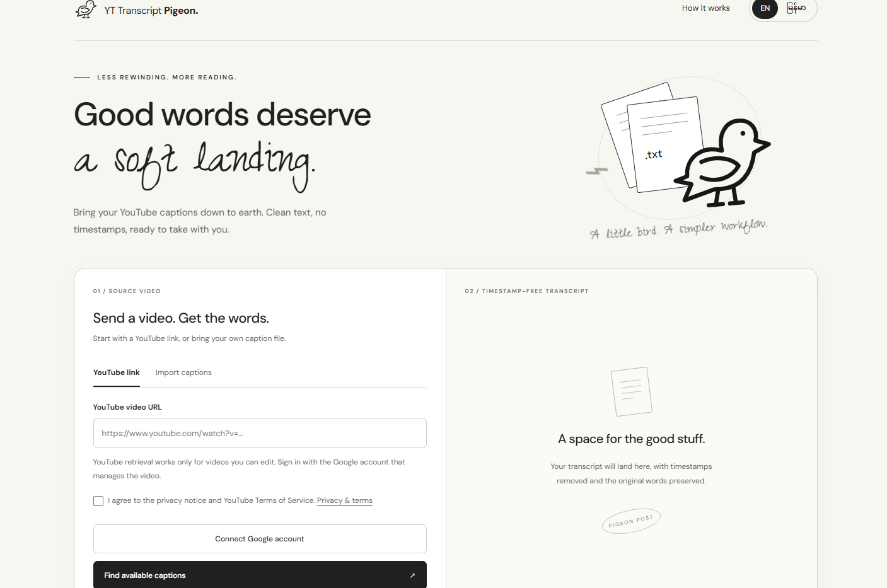
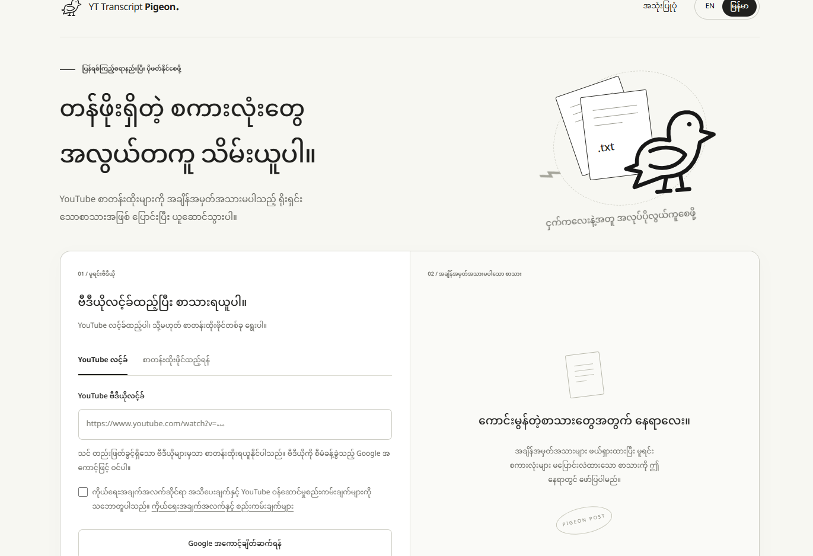

# YT Transcript Pigeon

Turn YouTube captions into timestamp-free text to read, copy, or download, with the source video link included.

[Access the live application here.](https://phyulwin.github.io/youtube_video_transcript_fetcher/)

Please note: The application will remain available for 30 days, after which the live deployment will be shut down to reserve API bills for another project.

## Get captions from YouTube

**Requires a Google account with permission to edit the video—not just watch it.**

1. Select **YouTube link** and paste the video URL.
2. Review and accept the privacy notice and terms, then select **Connect Google account**.
3. Select **Find available captions**.
4. Choose a caption language, then select **Retrieve transcript**.
5. Select **Copy text** or **Download .txt**.

## Use a caption file

For videos you cannot edit, use a caption file you own or are allowed to use; no Google sign-in is required.

1. Select **Import captions**, either from the tab or the prominent button shown when YouTube denies access.
2. Add the source YouTube URL and an optional title.
3. Choose an authorized `.srt` or `.vtt` file, up to 2 MB.
4. Select **Clean up captions** and review the preview.
5. Select **Download .txt** for a UTF-8 text file containing the clean transcript and source video link, or **Copy text**.

Subtitle timestamps, cue numbers, and markup are removed; spoken times such as “10:30,” Burmese text, and intentional repetition are preserved.

## Language and privacy

- **EN / မြန်မာ**: switch the interface, without translating captions.
- Imported files: processed entirely in your browser, never uploaded or stored on a server.
- Reload or disconnect: clears the current transcript and sign-in session; downloaded files remain.
- Full privacy details and Google access-revocation link: **Privacy & terms**.

## Having trouble?

- **Access denied:** select **Import captions** and choose a file you are allowed to use, or reconnect with an account that can edit the video.
- **File rejected:** choose a valid SRT or VTT caption file no larger than 2 MB.
- **No captions:** try another video or import a file.
- **Sign-in unavailable:** use file import or contact the site owner.
- **Session expired:** reconnect your Google account.
